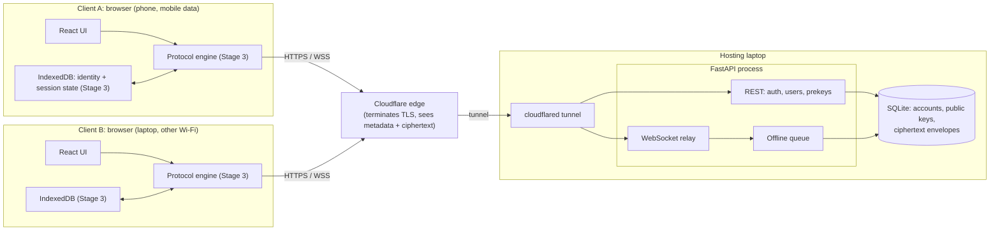
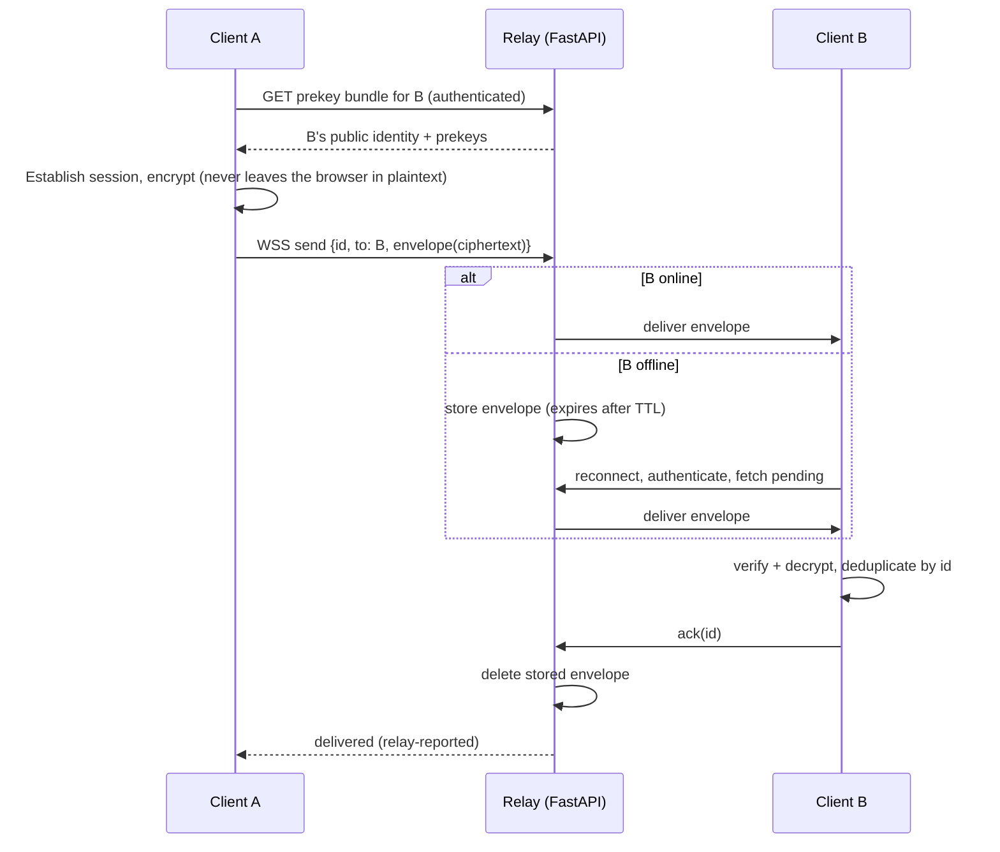

# Architecture

Derived from the uploaded `architecture.md` specification, adapted to a browser
client hosted from a single laptop and exposed through Cloudflare Tunnel.
Corrections to the specification are listed in `spec-review.md`.

## Message data flow (target design, Stages 2 to 4)

## Implementation status (Stage 2)

| Component | Status |
|---|---|
| Config loading with fail-safe validation | Implemented, tested |
| SQLite schema + initialisation, repository functions | Implemented, tested |
| Auth service (register/login/session/logout), password + token primitives | Implemented, tested |
| Validators, rate limiter, WebSocket ticket store | Implemented, tested |
| Relay logic (routing, offline queue, ack, dedup, limits) | Implemented, tested with fake sockets over real SQLite |
| FastAPI routes, WebSocket endpoint, middleware | Written, **not executed** |
| React auth screens, user search, relay status | Written, **not built or run** |
| E2EE protocol, identity verification, chat UI | Not started (Stage 3) |

## Trust boundaries

1. Browser ⇄ Cloudflare: TLS (Cloudflare can read HTTP-level data).
2. Cloudflare ⇄ laptop: Cloudflare Tunnel connection.
3. Relay process ⇄ SQLite: local file, mode 0600.
4. Browser tab ⇄ the code the relay delivered: **a malicious server can change this code** (see `THREAT_MODEL.md`).
