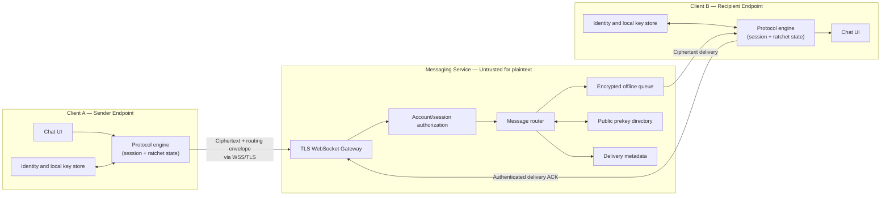

# End-to-End Encrypted Chat Application
## System Architecture and Design Specification

**Project domain:** Computer Networks and Application Security  
**Architecture style:** Client–server messaging with end-to-end encryption (E2EE)  
**Document status:** Proposed architecture; implementation and test results must be documented separately.

---

## 1. Project Overview

The project is a real-time messaging application in which two or more clients communicate through a central relay server. The server provides account/session handling, message routing, offline delivery, and delivery acknowledgements. Message plaintext and decryption-capable session secrets remain on the endpoint clients.

The server is **not trusted with message confidentiality**, but it is still part of the availability and metadata trust boundary. It can observe some routing metadata unless the design specifically hides it.

### Goals

- Provide real-time one-to-one messaging over a network.
- Encrypt and authenticate message contents on the sender's device.
- Ensure only an intended, authenticated recipient session can decrypt a message.
- Support offline recipients, reconnection, acknowledgements, and duplicate-safe delivery.
- Detect message tampering and reject replayed or invalid protocol messages.
- Measure latency, throughput, delivery reliability, and cryptographic overhead.
- Produce reproducible security tests and a demonstrable threat model.

### Out of scope for the initial version

- Group messaging, voice/video calls, multi-device synchronization, cloud backups, and anonymity against traffic analysis.
- Claiming formal verification or production-grade security without the corresponding review and evidence.
- Designing a new cryptographic protocol from scratch.

---

## 2. High-Level Architecture



**Important:** TLS protects each network connection in transit. E2EE separately protects the message content from the relay service. TLS alone is not end-to-end encryption.

---

## 3. Components and Responsibilities

### 3.1 Client application

Each client contains:

- **User interface:** contacts, conversation view, send/receive status, and verification status.
- **Identity manager:** creates and stores the user's long-term identity key material using platform-appropriate secure storage.
- **Session/key manager:** establishes sessions, stores protocol state, handles prekeys, and performs ratchet updates.
- **Cryptographic protocol adapter:** calls a maintained and reviewed implementation of the selected protocol. The application should not implement its own cryptographic primitives.
- **Message encoder/decoder:** serializes a versioned message envelope, validates fields, and passes authenticated plaintext to the UI only after successful verification.
- **Local persistence:** stores conversation state and any required encrypted local data. Secret material should be protected by OS facilities where available.

Plaintext exists on the sending and receiving endpoints while the user composes or reads messages. A compromised endpoint can expose plaintext or keys; E2EE does not solve endpoint compromise.

### 3.2 WebSocket gateway

- Accepts persistent client connections over **WSS** (WebSocket over TLS).
- Authenticates the account/session and authorizes each operation.
- Enforces payload-size limits, rate limits, connection limits, and schema validation.
- Does not receive plaintext message bodies or private session keys.
- Treats every client-supplied identifier and field as untrusted input.

### 3.3 Message router and offline queue

- Routes opaque encrypted envelopes to the recipient's active connection.
- Stores ciphertext temporarily when the recipient is offline.
- Retries delivery according to a documented policy.
- Uses stable message identifiers to support idempotent acknowledgement and duplicate handling.
- Deletes queued payloads after confirmed delivery or queue expiry, according to policy.

Delivery is generally **at-least-once** at the transport/application boundary. Clients must safely deduplicate repeated deliveries; do not promise exactly-once delivery across crashes and reconnects unless the implementation and evidence support it.

### 3.4 Public prekey directory

If the selected protocol uses asynchronous prekey-based session setup, the service publishes and serves **public** identity/prekey material. Private keys remain on their owners' clients. The implementation must prevent unauthorized prekey replacement where the protocol or account-authentication design requires it, and should track one-time prekey consumption correctly.

### 3.5 Database

Possible records:

| Record | Server-side content |
|---|---|
| Account | Account identifier, authentication verifier or identity-provider reference, status |
| Public key material | Public identity key and published public prekeys |
| Pending message | Recipient identifier, opaque ciphertext envelope, message ID, expiry |
| Delivery state | Queued/sent/acknowledged status and timestamps |
| Operational metadata | Rate-limit counters and limited diagnostics |

Never persist plaintext message bodies or client private keys on the relay server. Logs must avoid recording authentication tokens, private keys, plaintext, or full ciphertext unless there is a justified, documented test requirement. Even without plaintext, routing metadata can reveal who communicates with whom and when.

---

## 4. Network Protocol and Message Flow

### 4.1 Connection establishment

1. Client resolves the service hostname and establishes a TCP connection.
2. TLS authenticates the server and protects the connection.
3. The client opens a WebSocket over TLS.
4. The application authenticates the user and authorizes the session.
5. The client requests any pending messages and establishes or resumes a cryptographic session as needed.

WebSocket is an application protocol carried over TCP. TCP provides reliable, ordered bytes on one connection; it does not provide offline storage, end-to-end identity verification, or application-level deduplication.

### 4.2 Sending a message

1. The sender writes a message in the UI.
2. The client protocol engine obtains the appropriate session/message key and encrypts the content using the selected protocol's authenticated-encryption mechanism.
3. The client creates a versioned envelope containing only the fields needed for routing and protocol processing, such as a message ID, recipient/session reference, protocol version, and ciphertext.
4. The client sends the envelope to the service over WSS.
5. The server authenticates/authorizes the request, validates the envelope shape and limits, and routes or queues the opaque payload.
6. The recipient receives the envelope and passes it to the protocol engine.
7. The recipient verifies and decrypts the message. Invalid authentication or protocol state must result in rejection, not display of partial plaintext.
8. The recipient sends a delivery acknowledgement. The sender can display a status based on that acknowledgement.

### 4.3 Offline delivery and reconnection

- If the recipient is offline, the service queues the encrypted envelope until delivery or expiry.
- On reconnection, the client authenticates again and requests pending envelopes.
- The client deduplicates already-processed message IDs.
- Session state updates and message processing should be persisted safely so a crash does not accidentally reuse a message key or corrupt ratchet state.
- Define queue limits, expiry, retry intervals, and behavior when a device's local state is lost.

---

## 5. Cryptographic Design

### Recommended approach

Use a **maintained implementation of a published secure-messaging protocol** that supports the required platform and has a clear license and maintenance history. Follow its protocol-specific wire format and state rules. Do not combine arbitrary cryptographic components without a protocol specification.

A Signal-style design commonly separates:

- **Identity keys:** associate a cryptographic identity with an account/device.
- **Asynchronous session setup:** X3DH or the applicable successor such as PQXDH, depending on the chosen library and current protocol support.
- **Ongoing message protection:** a Double Ratchet implementation evolves message keys and session state.
- **Authenticated encryption (AEAD):** detects ciphertext modification and binds the protocol-defined associated data.
- **Key derivation:** protocol-defined KDFs derive independent keys from shared secret material.
- **Safety-number/fingerprint verification:** users compare a stable representation of identity keys through an authenticated out-of-band channel when practical.

Do not claim that merely rotating an AES key provides forward secrecy or post-compromise security. These properties depend on correct protocol state evolution, erasure of old secrets, and fresh secret contributions under the protocol's specified conditions.

### Authentication and integrity

Use the authenticated-encryption scheme required by the chosen protocol implementation. A separate HMAC is not automatically needed; adding one incorrectly can create key-management and protocol errors. If a protocol explicitly requires a MAC, follow its specification and key-separation requirements.

### Identity and man-in-the-middle risks

Encryption to an unverified public key can still encrypt a message to an attacker. The application should expose identity-key changes and provide a verification mechanism. Server authentication via TLS does not, by itself, prove that a recipient identity key has not been substituted by a malicious or compromised service.

### Key storage and state

- Keep private identity keys, session secrets, and ratchet state on clients.
- Use OS-backed key storage or a protected local database where feasible.
- Never write secrets to logs or crash reports.
- Treat local backup, device migration, and session reset as explicit security design decisions.
- Avoid restoring old ratchet state in a way that can reuse message keys.
- Document what happens after local data loss or account recovery.

---

## 6. Threat Model

### Adversaries considered

1. **Passive network observer:** can observe traffic, timing, endpoints, and approximate sizes.
2. **Active network attacker:** can delay, drop, reorder, or modify traffic, but cannot break correctly configured TLS or the cryptography.
3. **Malicious or compromised relay server:** can inspect server-side data, drop or replay envelopes, manipulate delivery, and attempt public-key substitution.
4. **Malicious authenticated user:** can send malformed or oversized requests and attempt unauthorized access.
5. **Compromised endpoint:** attacker controls a client device or process.

### Security goals

- Message confidentiality against the relay and network observers.
- Detection of ciphertext tampering through authenticated encryption.
- Rejection or safe deduplication of replayed application messages.
- Authorization of account actions and recipient routing.
- Detection of identity-key changes and support for key verification.
- Forward secrecy and post-compromise security **only to the extent supported by the correctly implemented protocol and tested behavior**.

### Limitations

- The server may learn account identifiers, communication timing, message size, and delivery relationships.
- The server can deny service, delay or discard messages, and potentially manipulate metadata.
- A compromised endpoint can read plaintext and steal local secrets.
- Screenshotting, copying, notification previews, and malicious operating-system software are outside the protection of transport encryption.
- Security tests demonstrate behavior for tested scenarios; they are not a formal proof of protocol security.

---

## 7. Security and Reliability Test Plan

| Test | Method | Expected result |
|---|---|---|
| Server plaintext inspection | Send unique marker text; inspect DB, queues, and logs | Marker is absent from server-side message storage/logs |
| Ciphertext tampering | Flip or truncate ciphertext bytes in a test harness | Recipient rejects message; no plaintext is shown |
| Replay | Submit the same envelope/message ID more than once | Duplicate is rejected or safely deduplicated |
| Unauthorized send/fetch | Use missing, invalid, or expired credentials | Request is denied |
| Identity substitution | Replace recipient public identity/prekey in a controlled test | Verification warning or protocol-defined failure occurs |
| Offline delivery | Send while recipient is disconnected, then reconnect | Message is delivered within the documented queue policy |
| Duplicate delivery | Force retry/acknowledgement loss | UI shows one logical message |
| Reconnection | Interrupt and restore network connectivity | Client reconnects and resumes without corrupting session state |
| Oversized/malformed payload | Send invalid schema and over-limit payloads | Request is rejected without server crash |
| Concurrent clients | Run several clients sending simultaneously | No cross-user message leakage; delivery accounting remains consistent |
| Session-state restart | Restart clients/server at controlled points | Session resumes or fails safely according to documented policy |
| Forward-secrecy demonstration | Use a protocol-aware test harness and controlled state compromise | Only make the claim supported by the protocol's defined test and evidence |

Use test accounts and synthetic messages. Keep attack simulations local and authorized.

---

## 8. Computer Networks Performance Evaluation

Measure network behavior separately from cryptographic correctness. Record the hardware, OS, runtime versions, network topology, payload sizes, client count, and test duration so results are reproducible.

### Metrics

- **End-to-end delivery latency:** time from sender submission to recipient authenticated receipt/decryption.
- **Median and P95 latency:** report distributions, not just one average.
- **Throughput:** successfully delivered logical messages per second, and optionally payload bytes per second.
- **Delivery success rate:** messages received successfully divided by messages submitted, with the test conditions stated.
- **Reconnect recovery time:** time from connectivity restoration to successful session/message delivery.
- **Encryption overhead:** compare a clearly defined baseline with the protected path; explain which steps are included.
- **Server resource use:** CPU, memory, queue depth, and database operations under load.

### Suggested experiments

1. Vary payload size, for example small text, medium text, and near-limit payloads.
2. Vary concurrent clients and message rate.
3. Compare online delivery with offline queue delivery.
4. Introduce controlled latency and packet loss using a local network emulator or traffic-control tool.
5. Measure reconnect behavior after short and long disconnects.
6. Compare baseline relay latency with the full E2EE path, while clearly noting that the baseline is not an equivalent security mode.

Do not fabricate benchmark values. Record raw results, repeat runs, and include environment details in the report.

---

## 9. Suggested Implementation Modules

```text
client/
  ui/
  networking/       # WSS connection, reconnect, request/response
  identity/         # identity display and verification UX
  crypto_adapter/   # wrapper around maintained protocol library
  session_store/    # protected local session state
  messaging/        # envelope, send/receive, deduplication
server/
  websocket_gateway/
  authentication/
  authorization/
  router/
  offline_queue/
  prekey_directory/
  persistence/
  rate_limits/
tests/
  unit/
  integration/
  security/
  performance/
docs/
  architecture.md
  threat-model.md
  protocol-decisions.md
  test-plan.md
  benchmark-methodology.md
```

These are logical modules; adapt the exact directory structure to the selected programming language and library.

---

## 10. Recommended Build Sequence

1. **Freeze scope and threat model.** Choose the target platform, language, protocol library, and supported client count.
2. **Build the network skeleton.** Implement authenticated WSS connections, routing, offline queues, and acknowledgements using dummy payloads.
3. **Integrate the protocol library.** Add session setup and encrypted messaging without changing protocol internals.
4. **Add durable client state.** Handle restart, reconnect, message identifiers, and duplicate delivery.
5. **Add verification UX.** Display identity fingerprints and key-change warnings.
6. **Automate security tests.** Include tampering, replay, unauthorized access, server inspection, and offline delivery.
7. **Run benchmarks.** Collect raw measurements and report median/P95 with reproducible conditions.
8. **Prepare the demonstration.** Show two clients, the server storing ciphertext only, a tampering/replay test being rejected, offline delivery, and benchmark output.

### Acceptance criteria

The project is ready for review when:

- Two independent clients exchange messages through the relay.
- Server-side storage and logs do not contain plaintext messages or private decryption keys.
- Invalid or tampered ciphertext is rejected by the client protocol implementation.
- Replay/duplicate behavior is tested and documented.
- Offline delivery and reconnection work under the defined queue policy.
- Identity verification or key-change handling is demonstrated.
- Automated tests and reproducible performance results are included.
- Every security claim in the final report is tied to an implemented feature and evidence.

---

## 11. Design Decisions to Record Before Coding

The following choices cannot be settled by architecture alone and must be recorded in the project repository:

- Target platform(s) and programming language.
- Exact maintained messaging-protocol library, version, license, and platform support.
- Whether session setup uses X3DH, PQXDH, or another supported protocol path.
- Authentication method and account-recovery policy.
- Local secret storage mechanism.
- Database and queue expiry/retention policy.
- Whether the server stores only opaque ciphertext envelopes and which metadata it retains.
- Test environment, network impairment method, and benchmark methodology.

**Final design principle:** keep the network service responsible for transport and delivery, keep message cryptography at the endpoints, use a maintained protocol implementation, and substantiate every security and performance claim with repeatable tests.
